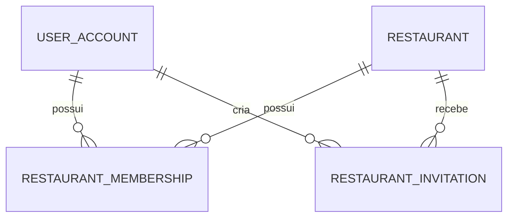

# Modelo de domínio e regras de acesso

## 1. Modelo implementado hoje

A fundação atual contém quatro entidades principais:

### UserAccount (`user_account`)
Representa a conta de uma pessoa.
- `id`: UUID.
- `full_name`: nome.
- `email`: único.
- `password_hash`: hash BCrypt, nunca senha em texto puro.
- `active`: indica se a conta pode autenticar.
- `created_at`, `updated_at`.

### Restaurant (`restaurant`)
Representa um estabelecimento cadastrado.
- `id`: UUID.
- `name`: nome.
- `slug`: identificador legível e único.
- `description`: descrição opcional.
- `active`: indica se o restaurante está ativo.
- `created_at`, `updated_at`.

### RestaurantMembership (`restaurant_membership`)
Vincula uma conta a um restaurante.
- `id`: UUID.
- `user_id`: referência a UserAccount.
- `restaurant_id`: referência a Restaurant.
- `role`: OWNER, MANAGER ou STAFF.
- `active`: vínculo ativo/inativo.
- `created_at`.
- Restrição única atual: um vínculo por par `user_id + restaurant_id`.

### RestaurantInvitation (`restaurant_invitation`)
Representa convite para integrar a equipe.
- `id`: UUID.
- `restaurant_id`: restaurante de destino.
- `email`: e-mail convidado.
- `role`: MANAGER ou STAFF.
- `token_hash`: hash SHA-256 do token; o token original não é persistido.
- `expires_at`: expiração.
- `accepted_at`: preenchido quando aceito.
- `created_by`: usuário que criou o convite.
- `created_at`.

## 2. Relacionamentos

Um usuário pode participar de vários restaurantes. Um restaurante pode ter vários membros e convites. A role pertence ao vínculo, não ao usuário global.

## 3. Papéis atuais

| Ação | OWNER | MANAGER | STAFF |
| --- | --- | --- | --- |
| Listar membros | Sim | Sim | Não |
| Criar convite | Sim | Não | Não |
| Convidar OWNER | Não | Não | Não |
| Alterar papel de membro | Sim | Não | Não |
| Remover membro | Sim | Não | Não |
| Alterar/remover OWNER | Não | Não | Não |
| Aceitar convite válido para o próprio e-mail | Sim, se convidado | Sim, se convidado | Sim, se convidado |

A tabela representa o comportamento implementado no módulo de equipe, não uma matriz completa de permissões futuras. Novas permissões devem ser definidas por caso de uso.

## 4. Regras de autorização

1. O token identifica o usuário; o cliente não escolhe o usuário efetivo da operação.
2. A autorização é validada no backend para cada restaurante.
3. O `restaurantId` da rota não prova vínculo nem permissão.
4. A membership deve estar ativa e pertencer ao restaurante solicitado.
5. O restaurante também deve estar ativo.
6. Não permitir escalada de privilégio por alteração de payload.
7. Remoção de membro é soft delete (`active=false)); não apagar vínculo histórico.
8. Ao aceitar convite, exigir que o e-mail autenticado corresponda ao e-mail convidado.
9. Ao reativar vínculo antigo, atualizar o papel conforme o convite válido, preservando o mesmo vínculo.

## 5. Multi-tenancy futuro

A direção definida é banco/schema compartilhado com `restaurant_id`/tenant em todo dado de propriedade do restaurante, com escopo obrigatório em queries e comandos. Avaliar PostgreSQL Row-Level Security como camada adicional.

Entidades futuras como categorias, produtos, mídia, campanhas e configurações devem possuir vínculo explícito com restaurante. Nunca buscar ou atualizar esses dados somente pelo ID do registro sem verificar o tenant.

## 6. Entidades futuras (não implementadas)

- MenuCategory e MenuItem.
- ProductOption / AddOn.
- MenuMedia / DishModel3D.
- LoyaltyProgram, LoyaltyAccount e LoyaltyTransaction.
- ClubWallet, ClubTransaction, PartnerBenefit e Settlement.
- RestaurantPublicProfile.
- ConsumerPreference.
- AuditEvent.
- PlatformAdmin / PlatformRole.

Este desenho é conceitual. Não criar todas as tabelas de uma vez; modelar cada módulo quando a etapa for priorizada.

## 7. Fidelidade e dinheiro/benefícios

Pontos e benefícios têm impacto financeiro e exigem consistência:
- Ledger imutável para movimentos; não editar saldo como única fonte de verdade.
- Transações atômicas para débito/crédito.
- Idempotency key para repetição de requisição.
- Registro de ator, origem, motivo, referência e timestamps.
- Regras de compensação entre parceiros e conciliação antes de Boraê Club real.
